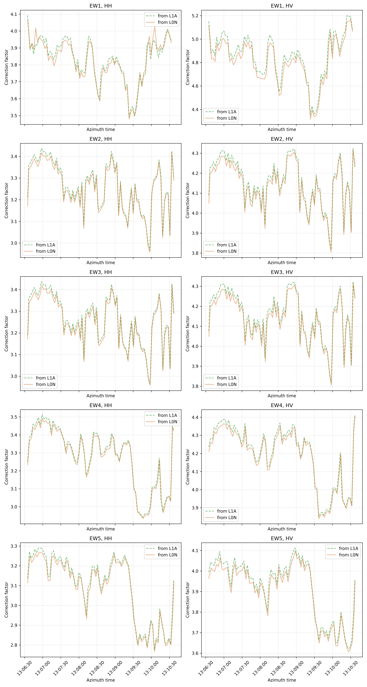

# Noise power extraction

When a Level 0 Noise (L0N) product is provided, the noise power is extracted from its raw measurements as follows.

1. **Raw packets are decoded** into I/Q samples. Pre-amble, rank echo and noise pulse measurements are compressed with
   plain Block Adaptive Quantization (BAQ, 3/4/5-bit modes) as described in [[RD5]](../API/bibliography.md#reference-documents),
   section 9.1, and are decoded into the raw quantizer codes accordingly. This is valid as long as the Threshold Index
   (THIDX) of each block stays below the ICD reconstruction threshold ([RD5], subsection 9.1.2.2), which always holds
   for the low-dynamic-range noise measurements used here and is verified at runtime.
2. **I/Q bias correction is applied** as discussed in [RD5], section 9.2.1. Since for Sentinel-1 data the
   demodulation is performed by the instrument's receive module in the digital domain, the I/Q gain imbalance and I/Q
   non-orthogonality corrections are not necessary. The correction is therefore equivalent to enforcing zero mean on
   both components of the signal.
3. **The mean noise power is computed** by reading and averaging separately each noise sequence from:
    - pre-amble measurements;
    - rank echo measurements (one mean noise power value for each rank echo sequence);
    - noise pulses, only present for S1C/D (one mean noise power value for each noise sequence);
    - post-amble measurements.
4. **Some rank echoes are discarded**, as they cannot all be used for noise estimation. Some echoes are affected by
   the stabilization pulses in the pre-amble, as well as by the TxCal/TxHCalIso pulses, as described in [RD5],
   subsection 4.2.1.9. In particular:
    - spikes observed in the rank echo measurements of the first burst of the data-take are removed for S1A/B (IW1 and
      EW1 subswaths), as they are biased by previous calibration and stabilization pulses;
    - the last rank echo of an EW1 sequence is removed for S1A/B, since nadir returns might be present;
    - rank echoes are filtered in an alternating pattern for S1A/B IW products, since odd-numbered measurements are
      biased by previous calibration pulses;
    - rank echo measurements for EW2 are replaced with those derived from EW3, for all Sentinel-1 units.

The extracted noise power then goes through the same [outlier rejection](noise-pulse-discard.md) applied to the noise
power annotated in L1 products.

Using L0N products to derive the noise power, instead of the noise power annotated by the IPF, does not reduce the
reconstruction precision (see [Validation](../validation.md#cross-type-dataset)). An example of noise power extraction
for an S1A EW product is shown below: the difference between the noise power extracted from the L1A product and from
the L0N product is lower than 0.05 dB.

<figure markdown="span">
  { width="65%" }
  <figcaption>Noise power extraction on an S1A EW product: from the L1A product (dashed green) vs from the L0N product (orange).</figcaption>
</figure>
