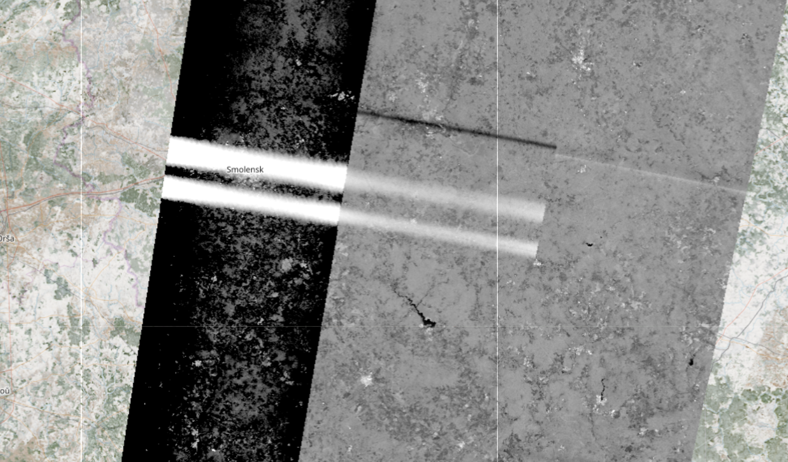
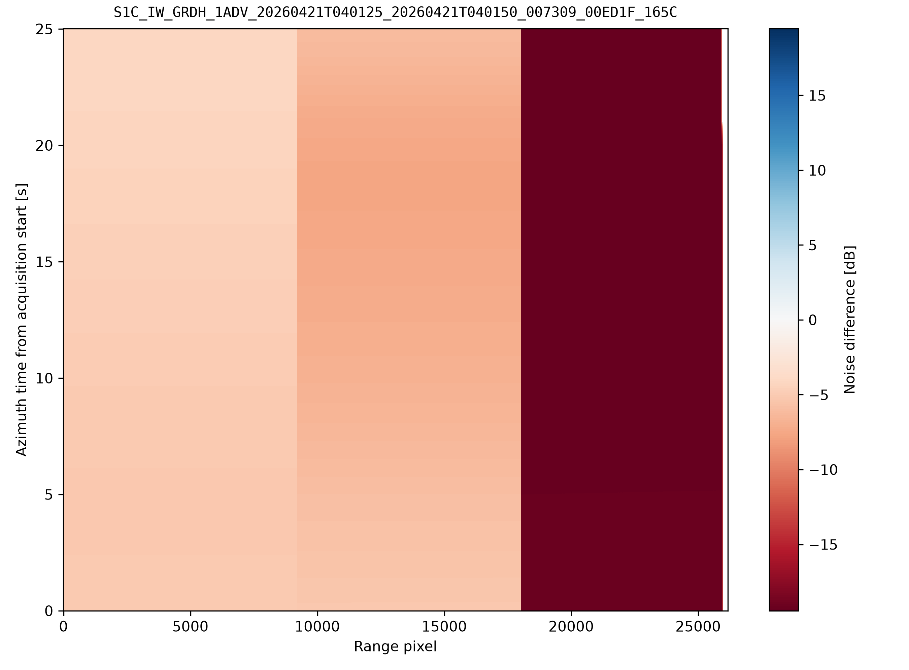
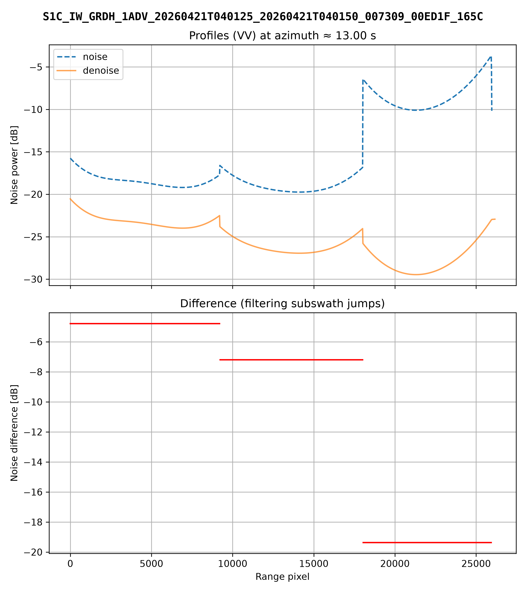

# Discard of noise pulses

## IPF approach

Before using the noise power estimates to generate a noise vector, the IPF performs a validation step: the differences
between consecutive noise estimates are compared against a threshold, and a noise measurement is discarded if the
threshold is exceeded, as described in [[RD5]](../API/bibliography.md#reference-documents), sections 4.2.1.9 and 4.2.2.

Since it is based only on the power variation between consecutive measurements, this approach fails when multiple
consecutive noise measurements show high power values: these are not discarded.

## L1N implementation

The S1 L1N processor follows a different approach: instead of relying on the statistics of the noise sequence itself,
each noise measurement is compared with the expected noise level of the instrument. For each channel (subswath and
polarization), AUX_INS provides the expected noise power $P_{\text{exp}}$ (the `noise` field of the internal
calibration parameters). A noise measurement $y_i$ is retained only if it falls within an interval around this value:

$$
P_{\text{exp}} \cdot 10^{-\Delta_{\text{low}} / 10} \le y_i \le P_{\text{exp}} \cdot 10^{\Delta_{\text{up}} / 10}
$$

with $\Delta_{\text{low}} = 3$ dB and $\Delta_{\text{up}} = 1$ dB. Given a sequence of observations
$Y = \{y_1, y_2, \dots, y_n\}$ in linear scale, the cleaned dataset is therefore:

$$
Y_{\text{clean}} = \left\{ y_i \in Y : P_{\text{exp}} \cdot 10^{-\Delta_{\text{low}} / 10} \le y_i \le P_{\text{exp}} \cdot 10^{\Delta_{\text{up}} / 10} \right\}
$$

The interval is asymmetric: measurements exceeding the expected level by more than 1 dB, as in case of RFI
contamination, are discarded, while the tolerance towards lower values is wider. Since the reference is external to the
noise sequence, the criterion does not depend on the number of contaminated measurements: even when several consecutive
noise pulses are affected by RFI, they are still identified and discarded. Moreover, no minimum number of observations
is required.

The filter is applied both to the noise power annotated in the L1A/S product and to the one
[extracted from L0N products](noise-power-extraction.md), and each discarded noise pulse is reported in the processor
log. If all the noise measurements of a channel are discarded, the nominal expected noise power $P_{\text{exp}}$ read
from AUX_INS is used as a constant noise power for the whole channel, and a warning is issued.

The outlier detection is implemented as follows:

```python title="s1_denoise/utils.py"
def remove_outliers(azimuth_times, noise_pulses, expected_noise_value):

    azimuth_times = np.array(azimuth_times)
    noise_pulses = np.array(noise_pulses, dtype=float)
    min_value = expected_noise_value * db_to_linear(-NOISE_LOWER_BOUND)
    max_value = expected_noise_value * db_to_linear(NOISE_UPPER_BOUND)

    # Detect outliers
    mask = (noise_pulses < min_value) | (noise_pulses > max_value)
    indices = np.where(mask)[0]

    # Collect outlier info (already sorted by original index)
    outlier_indices = [[idx, azimuth_times[idx], noise_pulses[idx]] for idx in indices]

    # Remove outliers
    azimuth_times_clean = azimuth_times[~mask]
    noise_pulses_clean = noise_pulses[~mask]

    return azimuth_times_clean, noise_pulses_clean, outlier_indices
```

where `NOISE_LOWER_BOUND` and `NOISE_UPPER_BOUND` are the bounds $\Delta_{\text{low}}$ and $\Delta_{\text{up}}$ in
dB, set by default to 3.0 and 1.0 respectively.

## Example of application

The two approaches may yield different results in case of RFI contamination, as in the data-take
`S1C_IW_GRDH_1ADV_20260421T040125_20260421T040150_007309_00ED1F_E017.SAFE`.

The following figure shows a portion of this data-take from the CDSE browser, after denoising: the noise maps
estimated by the IPF have already been removed from the data. Two things can be observed:

- RFI contamination is clearly present in both the IW2 and IW3 subswaths;
- for IW3 (the subswath on the left), a wrong noise level has been estimated and removed from the data, causing a
  saturation in the color scale.

This happened because the RFI contaminated more than one consecutive noise pulse of IW3, so that the IPF failed to
identify the outliers.

<figure markdown="span">
  { width="80%" }
  <figcaption>IW VV polarization, γ<sup>0</sup> layer in dB, just outside Moscow on April 21<sup>st</sup> 2026, from the CDSE browser.</figcaption>
</figure>

Comparing the nominal noise annotations with the output of the S1 L1N processor, the latter yields a more consistent
and continuous thermal noise level across the whole acquisition. The difference between the annotated and the
reconstructed noise maps shows a pronounced discrepancy within the IW3 subswath.

<figure markdown="span">
  { width="60%" }
  <figcaption>Difference between annotated and reconstructed noise maps.</figcaption>
</figure>

The noise profiles at a fixed azimuth time make this even clearer: the IPF generally over-estimates the noise level in
all three subswaths of this product, and computes a completely wrong level for IW3, due to the RFI contamination of the
noise pulses.

<figure markdown="span">
  { width="80%" }
  <figcaption>Annotated and reconstructed noise profiles, VV polarization.</figcaption>
</figure>
