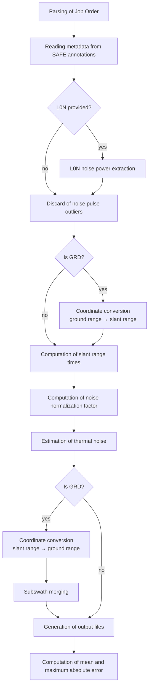

# Processing pipeline

The processing pipeline implemented by the processor is summarized in the following flow chart. Refer to
[[RD1]](../API/bibliography.md#reference-documents) for the theoretical details.



1. **Parsing of Job Order**
   The processor reads every file path given in the [Job Order](../user-guide/job-order.md) and checks that it is
   reachable from the current working directory. The expected inputs are the L1A/S product(s) (S1A/B/C/D), the
   AUX_INS, AUX_CAL and AUX_PP1 products and, optionally, the L0N product(s). Additional checks are performed:
    - the AUX files provided by the user are compared with those used to generate each L1 product, to minimize the
      reconstruction error; if they differ, a warning is issued, but processing continues;
    - L1A/S and L0N products are paired automatically when products from different data-takes are provided together;
    - the output folder must be different from the input folders.

2. **Reading metadata from SAFE annotations**
   Input products and auxiliary files are parsed and stored in dedicated classes for quick and easy access.

3. **L0N noise power extraction (optional)**
   If no L0N product is provided, the noise power is read from the noise list annotated in the L1A/S product.
   Otherwise, it is extracted from the Level 0 noise measurements, as described in
   [Noise power extraction](noise-power-extraction.md).

4. **Discard of noise pulses**
   Whatever the source of the noise power, the measurements outside an interval around the expected noise level read
   from AUX_INS are discarded as outliers. See [Discard of noise pulses](noise-pulse-discard.md).

5. **Coordinate conversion**
   For GRD products, the `coordinateConversion` section of the annotations provides a 9th-degree polynomial converting
   ground range into slant range. This allows reusing the SLC algorithms without introducing further differences
   between the SLC and GRD pipelines.

6. **Computation of slant range times**
   For each burst of each subswath, slant range times are computed together with range distances and range spreading
   loss.

7. **Computation of noise normalization factor**
   The IPF computes internally a multiplicative constant for each burst, which depends on the windowing and
   multi-looking of the acquisition. See [Noise normalization factor](normalization-factor.md).

8. **Estimation of thermal noise**
   The thermal noise of the burst is computed as

    ```python
    simulated_noise = np.sin(incidence_angles) * noise_power * G_tot * noise_norm_factor
    ```

    where `G_tot` combines all the radiometric corrections applied by the IPF, following the
    [denoising vector model](index.md#denoising-vector-model):

    ```python
    G_tot = pg**2 * k_N * k_proc / (elevation_pattern * range_spread_losses)
    ```

    For GRD products, the noise values are then converted back from slant range to ground range.

9. **Subswath merging**
   For GRD products, the subswaths merged in the same annotation file are processed separately and then merged into a
   single cross-subswath file. See [Subswath merging](subswath-merging.md).

10. **Generation of output files**
    Noise range vectors are written to an XML file, while noise azimuth vectors are not modified. See
    [Outputs](../user-guide/outputs.md).

11. **Computation of mean absolute error**
    The nominal noise annotations and the generated denoise files are parsed (and interpolated, in the GRD case) to
    compute the mean and maximum absolute error, providing an estimate of the reconstruction quality.
