# Validation

The reconstruction quality is measured by the **mean absolute error (MAE)** and the **maximum absolute error** between
the noise maps annotated by the IPF and those reconstructed by the processor, over the whole acquisition, in dB.

## One day analysis

To validate the processor over a significant dataset, a whole day of acquisitions was considered for each mission, to
ensure that no orbit-dependent bias is introduced by the processor algorithms. Only SLC products were considered, with
no additional L0N input. Note that during operational acquisitions EW products are significantly fewer than IW
products in a single day.

| Mission ID | Day of acquisition | Number of products     |
|:----------:|:------------------:|:----------------------:|
| S1A        | 03/03/2025         | 574 (558 IW + 16 EW)   |
| S1C        | 26/02/2026         | 439 (432 IW + 7 EW)    |
| S1D        | 17/04/2026         | 494 (404 IW + 90 EW)   |

The average MAE over all analyzed cases is very small, around 0.016 dB, indicating a very good reconstruction
capability of the processor for SLC products.

<figure markdown="span">
  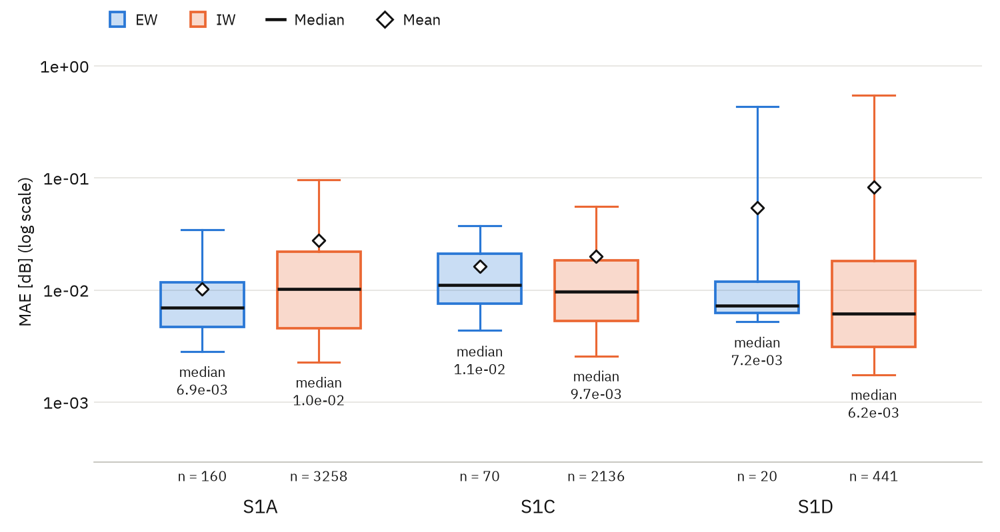
  <figcaption><strong>Mean</strong> absolute errors between annotated and reconstructed noise maps over all products of the test dataset (box: 25th–75th percentile, whiskers: 5th–95th percentile). The numbers <em>n</em> at the bottom of the columns indicate the number of denoise files (i.e. subswath + polarization channels) generated and parsed for error calculation.</figcaption>
</figure>

<figure markdown="span">
  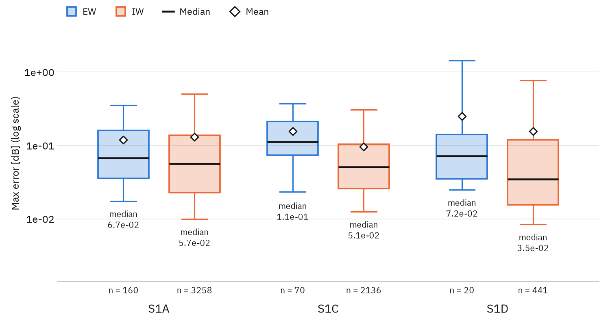
  <figcaption>Average <strong>maximum</strong> absolute errors between annotated and reconstructed noise maps over all products of the test dataset (box: 25th–75th percentile, whiskers: 5th–95th percentile).</figcaption>
</figure>

## Cross-type dataset

The processor was also tested on all three operating units (S1A, S1C and S1D) using both SLC and GRD data. Each L1A
product was processed twice: once extracting the noise power from the corresponding L0N product, and once reading it
directly from the L1A annotations.

??? info "L1A products of the test dataset"

    | ID  | L1A product name |
    |-----|------------------|
    | S1A | `S1A_EW_GRDM_1ADH_20250906T230229_20250906T230314_060873_079499_B099` `S1A_EW_GRDM_1ADV_20250915T223810_20250915T223914_061004_0799D6_EA11` `S1A_EW_SLC__1ADH_20250906T230229_20250906T230314_060873_079499_988E` `S1A_EW_SLC__1ADV_20250915T223810_20250915T223916_061004_0799D6_34D2` `S1A_IW_GRDH_1ADH_20250302T101348_20250302T101413_058124_072DD8_5166` `S1A_IW_GRDH_1ADV_20250505T172037_20250505T172102_059062_07539E_4F63` `S1A_IW_SLC__1ADH_20250302T101348_20250302T101415_058124_072DD8_FD58` `S1A_IW_SLC__1ADV_20250505T171215_20250505T171243_059062_07539E_4E4F` |
    | S1C | `S1C_EW_GRDM_1ADH_20260226T125724_20260226T125824_006527_00D27D_533E` `S1C_EW_GRDM_1ADV_20260222T225359_20260222T225441_006474_00D0B5_D099` `S1C_EW_SLC__1ADH_20260226T125823_20260226T125925_006527_00D27D_ABEF` `S1C_EW_SLC__1ADV_20260222T225359_20260222T225441_006474_00D0B5_B47D` `S1C_IW_GRDH_1ADH_20260226T094036_20260226T094101_006525_00D266_D8C1` `S1C_IW_GRDH_1ADV_20260226T042240_20260226T042310_006522_00D246_2B4A` `S1C_IW_SLC__1ADH_20260226T094035_20260226T094102_006525_00D266_0DC1` `S1C_IW_SLC__1ADV_20260226T042240_20260226T042310_006522_00D246_D3DF` |
    | S1D | `S1D_EW_GRDM_1ADH_20260421T193955_20260421T194100_002449_00406A_49A4` `S1D_EW_GRDM_1ADV_20260421T192114_20260421T192214_002449_004066_447B` `S1D_EW_SLC__1ADH_20260421T194158_20260421T194301_002449_00406A_4855` `S1D_EW_SLC__1ADV_20260421T192012_20260421T192115_002449_004066_F5EE` `S1D_IW_GRDH_1ADH_20260420T185333_20260420T185358_002434_003FF4_3355` `S1D_IW_GRDH_1ADV_20260420T183231_20260420T183300_002433_003FF0_C3A0` `S1D_IW_SLC__1ADH_20260420T185307_20260420T185334_002434_003FF4_6454` `S1D_IW_SLC__1ADV_20260420T183231_20260420T183302_002433_003FF0_4C94` |

??? info "L0N products of the test dataset"

    | ID  | L0N product name |
    |-----|------------------|
    | S1A | `S1A_EW_RAW__0NDH_20250906T230229_20250906T230314_060873_079499_F0C7` `S1A_EW_RAW__0NDV_20250915T223810_20250915T223929_061004_0799D6_4D40` `S1A_IW_RAW__0NDH_20250302T101255_20250302T101509_058124_072DD8_4752` `S1A_IW_RAW__0NDV_20250505T171148_20250505T172257_059062_07539E_6E38` |
    | S1C | `S1C_EW_RAW__0NDH_20260226T125520_20260226T130108_006527_00D27D_75AA` `S1C_EW_RAW__0NDV_20260222T225400_20260222T225441_006474_00D0B5_D3A3` `S1C_IW_RAW__0NDH_20260226T093917_20260226T094215_006525_00D266_7487` `S1C_IW_RAW__0NDV_20260226T042241_20260226T042310_006522_00D246_2F62` |
    | S1D | `S1D_EW_RAW__0NDH_20260421T193956_20260421T194428_002449_00406A_6AFC` `S1D_EW_RAW__0NDV_20260421T191910_20260421T192546_002449_004066_A043` `S1D_IW_RAW__0NDH_20260420T185240_20260420T185554_002434_003FF4_888B` `S1D_IW_RAW__0NDV_20260420T183231_20260420T183355_002433_003FF0_6FD8` |

The precision of the denoising procedure is not significantly affected by the use of L0N products to extract the noise
power. The highest average MAE over all analyzed cases is around $1.25 \cdot 10^{-1}$ dB, indicating a very good
reconstruction capability also for GRD products.

<figure markdown="span">
  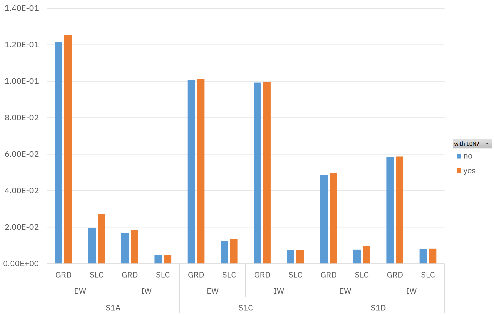{ width="90%" }
  <figcaption>Mean absolute errors between annotated and reconstructed noise maps on all test products, for all operating missions (S1A/C/D), acquisition modes (IW, EW), levels (SLC, GRD), and usage (or not) of L0N products.</figcaption>
</figure>

### SLC data

The reconstruction of SLC noise maps is the most precise: the MAE is around $1.09 \cdot 10^{-2}$ dB when the noise
power is read from the L1 annotations, and $1.31 \cdot 10^{-2}$ dB when it is extracted from the L0N product.

<figure markdown="span">
  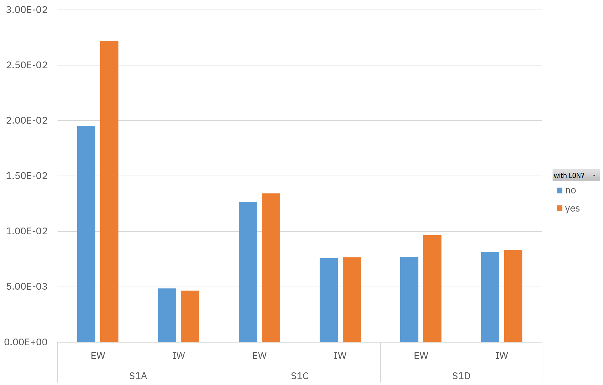{ width="85%" }
  <figcaption>Mean absolute errors between annotated and reconstructed noise maps on SLC products.</figcaption>
</figure>

<figure markdown="span">
  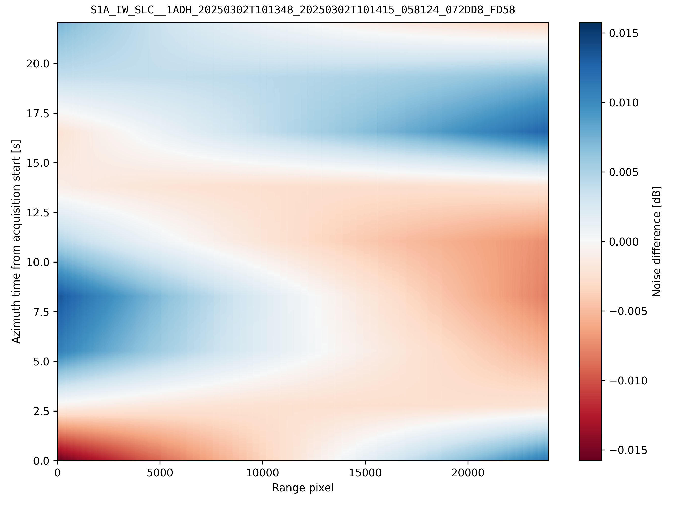{ width="78%" }
  <figcaption>Error between annotated and reconstructed noise maps of an S1A IW SLC product, IW3, HH polarization, no L0N.</figcaption>
</figure>

Comparing nominal and reconstructed noise profiles at a fixed azimuth time, some oscillations are visible. For
subswath EW1, VH polarization of an S1C SLC product, the error over the whole profile is of the order of $10^{-3}$ dB:
the oscillations along the profile are introduced by floating point precision and numerical errors.

<figure markdown="span">
  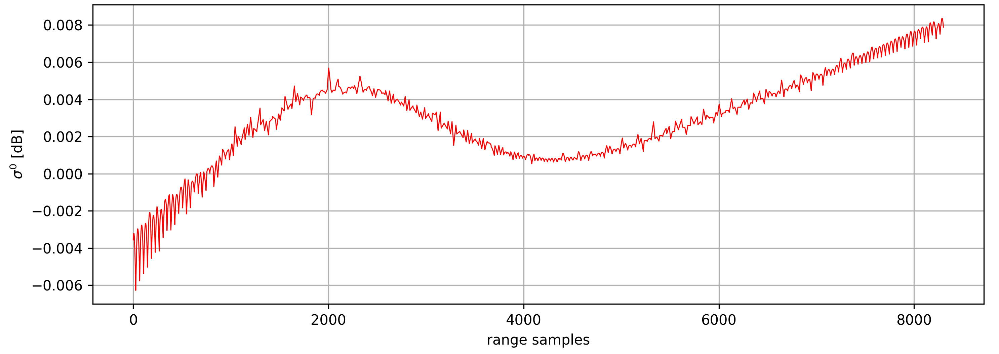
  <figcaption>Error between annotated and reconstructed noise profiles for product <code>S1C_EW_SLC__1ADV_20250502T191252_20250502T191355_002156_00493A_0D61</code>, no L0N.</figcaption>
</figure>

### GRD data

For GRD products the error is slightly higher than for SLC products: $7.4 \cdot 10^{-2}$ dB when the noise power is
read from the L1 annotations, and $7.5 \cdot 10^{-2}$ dB when it is extracted from the L0N product. This is still very
small, and acceptable for the scope of this work.

<figure markdown="span">
  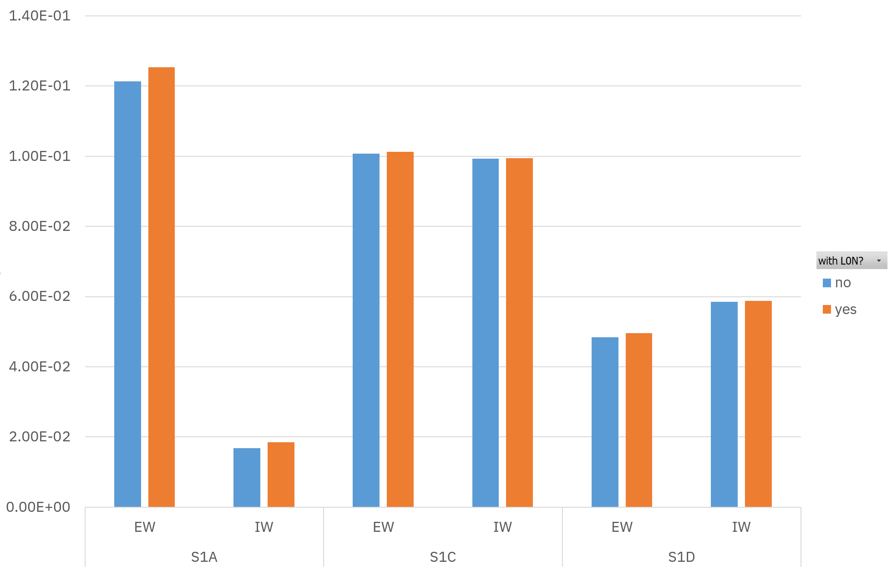{ width="85%" }
  <figcaption>Mean absolute errors between annotated and reconstructed noise maps on GRD products.</figcaption>
</figure>

The GRD case is more delicate, mainly because the subswaths must be correctly separated, processed and
[merged](algorithm/subswath-merging.md) from a single annotation file. For GRDH products this procedure is easier and
the error stays low, as in the following S1C IW GRDH example.

<figure markdown="span">
  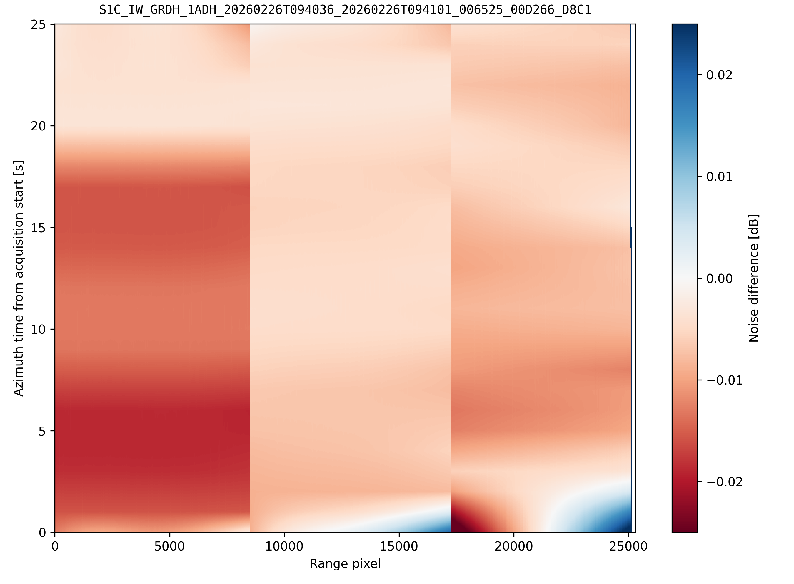
  <figcaption>Difference between annotated and reconstructed noise maps, HV polarization.</figcaption>
</figure>

GRDM products have more irregular acquisition borders, and are therefore more prone to numerical imprecision. In the
following S1A and S1C EW GRDM examples, high-error areas are visible in the rightmost part of the map and at its
bottom, respectively.

<figure markdown="span">
  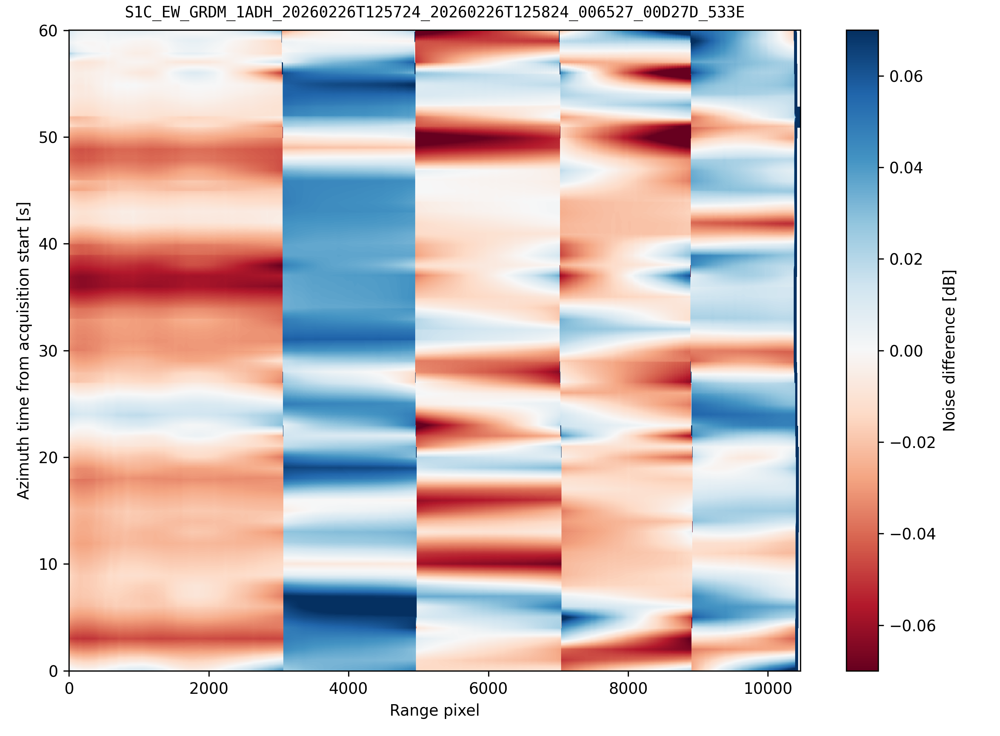
  <figcaption>Difference between annotated and reconstructed noise maps, HV polarization.</figcaption>
</figure>

<figure markdown="span">
  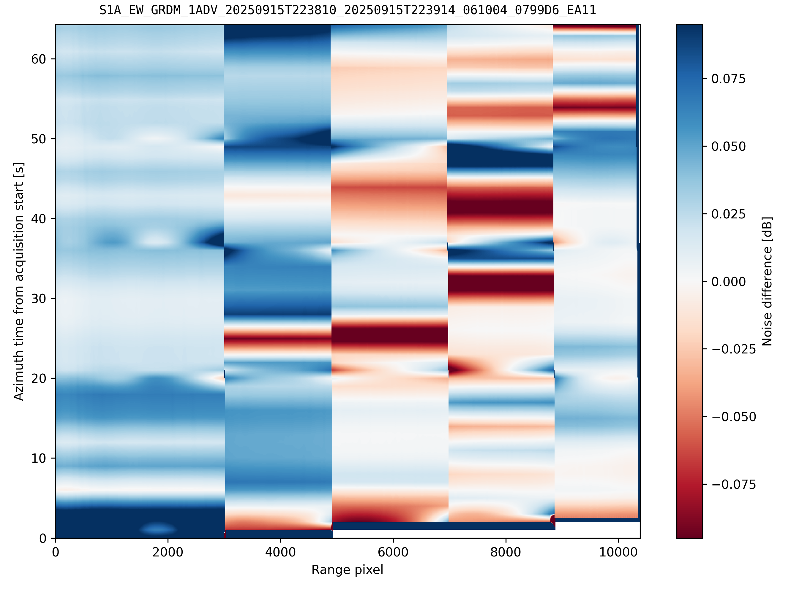
  <figcaption>Difference between annotated and reconstructed noise maps, VH polarization.</figcaption>
</figure>

!!! note "Expected residual differences"

    - **Far-range edge.** At the far-range edge of the outermost subswaths, the nominal annotations set the last 1-3
      noise LUT samples to zero, as visible in the profiles below. This is an empirically observed behavior of the IPF
      output, consistent with the noise estimator lacking valid samples at the extreme antenna beam edge. The processor
      computes a physically meaningful value there by design, so small residual differences at boundary pixels are
      expected and do not indicate a processing error.
    - **Start of the acquisition.** Narrow horizontal high-error bands may appear across all subswaths at the start of
      the acquisition, because the first valid burst of each subswath begins slightly after the product `startTime`,
      requiring a backward extrapolation of the noise profile. The IPF empirical estimator, working directly on the
      measured data, may yield different values in those initial seconds. The artifact is confined to the opening
      seconds of the scene and does not affect the overall noise model quality.

    Any interpolation-based comparison produces an arbitrarily large dB difference in these regions, regardless of the
    model accuracy. The maximum absolute error is therefore dominated by these artifacts and is not a meaningful
    quality indicator: the mean absolute error is the appropriate figure of merit.

<figure markdown="span">
  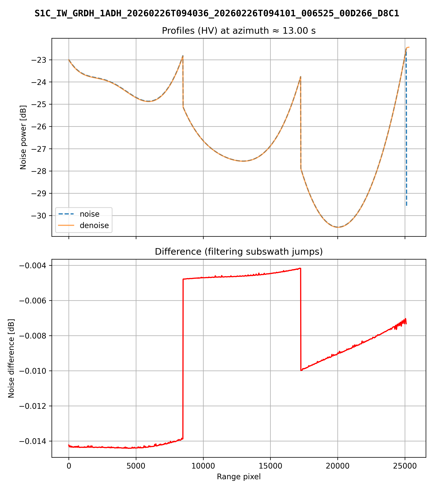{ width="90%" }
  <figcaption>Annotated and reconstructed noise profiles of a GRDH product, HV polarization.</figcaption>
</figure>

<figure markdown="span">
  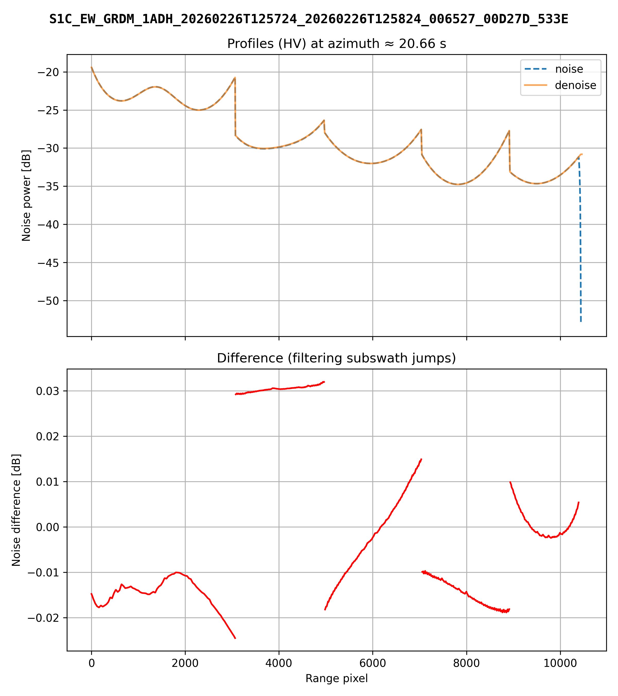{ width="90%" }
  <figcaption>Annotated and reconstructed noise profiles of a GRDM product, HV polarization.</figcaption>
</figure>
