# Validation

The reconstruction quality is measured by the **mean absolute error (MAE)** and the **maximum absolute error** between
the noise maps annotated by the IPF and those reconstructed by the processor, over the whole acquisition, in dB. The complete validation results are reported in the processor Technical Note [[RD6]](API/bibliography.md#reference-documents).

## One day analysis

To validate the processor over a significant dataset, a whole day of acquisitions was considered for each mission, to
ensure that no orbit-dependent bias is introduced by the processor algorithms. Only SLC products were considered, with
no additional L0N input. Note that during operational acquisitions EW products are significantly fewer than IW
products in a single day.

| Mission ID | Day of acquisition | Number of products     |
|:----------:|:------------------:|:----------------------:|
| S1A        | 03/03/2025         | 574 (558 IW + 16 EW)   |
| S1C        | 26/02/2026         | 405 (398 IW + 7 EW)    |
| S1D        | 17/04/2026         | 541 (442 IW + 99 EW)   |

The median MAE over all the 9152 analyzed denoise files is very small, around 0.0096 dB (between 0.005 and 0.011 dB
for each mission and acquisition mode), indicating a very good reconstruction capability of the processor for SLC
products.

!!! note "S1A IW outliers"

    The average MAE, around 0.046 dB, is dominated by 45 S1A IW denoise files (0.5% of the total) with MAE above 1 dB;
    excluding them, the average MAE is around 0.022 dB. In these products the noise power annotated by the IPF exceeds
    the expected noise level read from AUX_INS by more than the upper bound of the
    [discard interval](algorithm/noise-pulse-discard.md), up to +14 dB at the start of some data-takes, where it then
    decreases over the first minutes of acquisition. These noise measurements are discarded by the processor, and the
    noise power is interpolated from the retained ones, resulting in a reconstructed noise level up to several dB lower
    than the one annotated by the IPF, which uses them.

<figure markdown="span">
  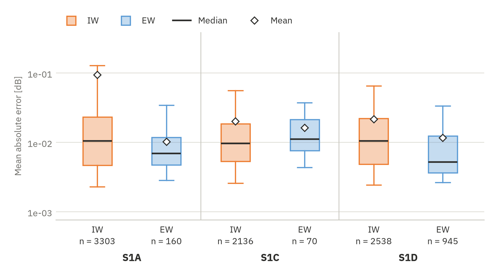
  <figcaption><strong>Mean</strong> absolute errors between annotated and reconstructed noise maps over all products of the test dataset, per mission and acquisition mode (box: 25th–75th percentile, whiskers: 5th–95th percentile, line: median, diamond: mean). The numbers <em>n</em> below the acquisition modes indicate the number of denoise files (i.e. subswath + polarization channels) generated and parsed for error calculation.</figcaption>
</figure>

<figure markdown="span">
  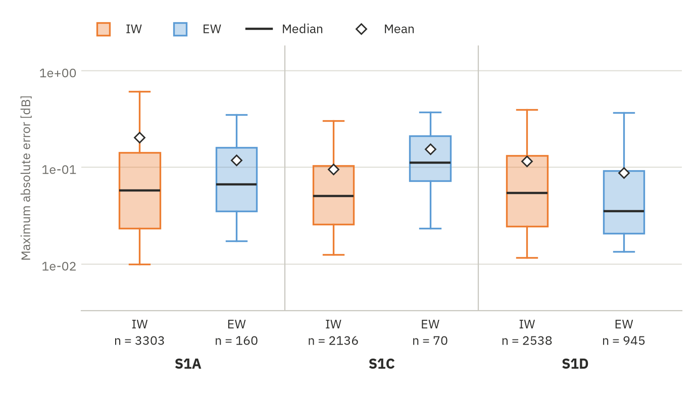
  <figcaption><strong>Maximum</strong> absolute errors between annotated and reconstructed noise maps over all products of the test dataset, per mission and acquisition mode (box: 25th–75th percentile, whiskers: 5th–95th percentile, line: median, diamond: mean).</figcaption>
</figure>

## Cross-type dataset

The processor was also tested on all three operating units (S1A, S1C and S1D) using both SLC and GRD data. Each L1A
product was processed twice: once extracting the noise power from the corresponding L0N product, and once reading it
directly from the L1A annotations.

??? info "L1A products of the test dataset"

    | ID  | L1A product name |
    |-----|------------------|
    | S1A | `S1A_EW_GRDM_1ADH_20250906T230229_20250906T230314_060873_079499_B099` `S1A_EW_GRDM_1ADV_20250915T223810_20250915T223914_061004_0799D6_EA11` `S1A_EW_SLC__1ADH_20250906T230229_20250906T230314_060873_079499_988E` `S1A_EW_SLC__1ADV_20250915T223810_20250915T223916_061004_0799D6_34D2` `S1A_IW_GRDH_1ADH_20250302T101348_20250302T101413_058124_072DD8_5166` `S1A_IW_GRDH_1ADV_20250505T172037_20250505T172102_059062_07539E_4F63` `S1A_IW_SLC__1ADH_20250302T101348_20250302T101415_058124_072DD8_FD58` `S1A_IW_SLC__1ADV_20250505T171215_20250505T171243_059062_07539E_4E4F` |
    | S1C | `S1C_EW_GRDM_1ADH_20260226T125724_20260226T125824_006527_00D27D_533E` `S1C_EW_GRDM_1ADV_20260222T225359_20260222T225441_006474_00D0B5_D099` `S1C_EW_SLC__1ADH_20260226T125823_20260226T125925_006527_00D27D_ABEF` `S1C_EW_SLC__1ADV_20260222T225359_20260222T225441_006474_00D0B5_B47D` `S1C_IW_GRDH_1ADH_20260226T094036_20260226T094101_006525_00D266_D8C1` `S1C_IW_GRDH_1ADV_20260226T042240_20260226T042310_006522_00D246_2B4A` `S1C_IW_SLC__1ADH_20260226T094035_20260226T094102_006525_00D266_0DC1` `S1C_IW_SLC__1ADV_20260226T042240_20260226T042310_006522_00D246_D3DF` |
    | S1D | `S1D_EW_GRDM_1ADH_20260421T193955_20260421T194100_002449_00406A_49A4` `S1D_EW_GRDM_1ADV_20260421T192114_20260421T192214_002449_004066_447B` `S1D_EW_SLC__1ADH_20260421T194158_20260421T194301_002449_00406A_4855` `S1D_EW_SLC__1ADV_20260421T192012_20260421T192115_002449_004066_F5EE` `S1D_IW_GRDH_1ADH_20260420T185333_20260420T185358_002434_003FF4_3355` `S1D_IW_GRDH_1ADV_20260420T183231_20260420T183300_002433_003FF0_C3A0` `S1D_IW_SLC__1ADH_20260420T185307_20260420T185334_002434_003FF4_6454` `S1D_IW_SLC__1ADV_20260420T183231_20260420T183302_002433_003FF0_4C94` |

??? info "L0N products of the test dataset"

    | ID  | L0N product name |
    |-----|------------------|
    | S1A | `S1A_EW_RAW__0NDH_20250906T230229_20250906T230314_060873_079499_F0C7` `S1A_EW_RAW__0NDV_20250915T223810_20250915T223929_061004_0799D6_4D40` `S1A_IW_RAW__0NDH_20250302T101255_20250302T101509_058124_072DD8_4752` `S1A_IW_RAW__0NDV_20250505T171148_20250505T172257_059062_07539E_6E38` |
    | S1C | `S1C_EW_RAW__0NDH_20260226T125520_20260226T130108_006527_00D27D_75AA` `S1C_EW_RAW__0NDV_20260222T225400_20260222T225441_006474_00D0B5_D3A3` `S1C_IW_RAW__0NDH_20260226T093917_20260226T094215_006525_00D266_7487` `S1C_IW_RAW__0NDV_20260226T042241_20260226T042310_006522_00D246_2F62` |
    | S1D | `S1D_EW_RAW__0NDH_20260421T193956_20260421T194428_002449_00406A_6AFC` `S1D_EW_RAW__0NDV_20260421T191910_20260421T192546_002449_004066_A043` `S1D_IW_RAW__0NDH_20260420T185240_20260420T185554_002434_003FF4_888B` `S1D_IW_RAW__0NDV_20260420T183231_20260420T183355_002433_003FF0_6FD8` |

The precision of the denoising procedure is not significantly affected by the use of L0N products to extract the noise
power. The highest average MAE over all analyzed cases is around $3.4 \cdot 10^{-2}$ dB, indicating a very good
reconstruction capability also for GRD products. The figures of this section also report, for S1C, the
[Stripmap and Wave mode](#stripmap-and-wave-mode-dataset) products.

<figure markdown="span">
  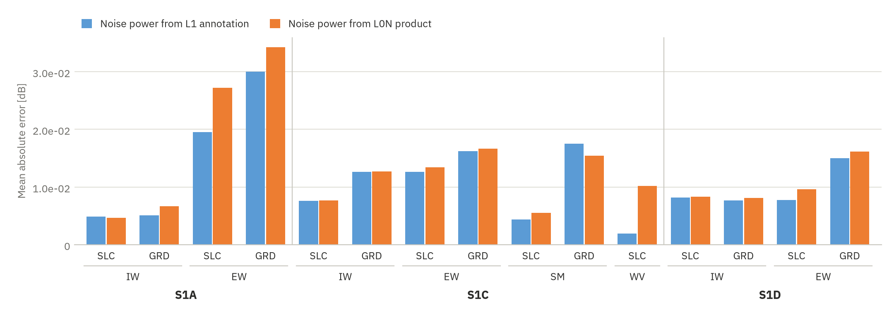{ width="90%" }
  <figcaption>Mean absolute errors between annotated and reconstructed noise maps on all test products, for all operating missions (S1A/C/D), acquisition modes (IW, EW, and SM, WV for S1C), levels (SLC, GRD), and usage (or not) of L0N products.</figcaption>
</figure>

### SLC data

The reconstruction of SLC noise maps is the most precise: for the TopSAR products, the MAE is around
$1.09 \cdot 10^{-2}$ dB when the noise power is read from the L1 annotations, and $1.31 \cdot 10^{-2}$ dB when it is
extracted from the L0N product.

<figure markdown="span">
  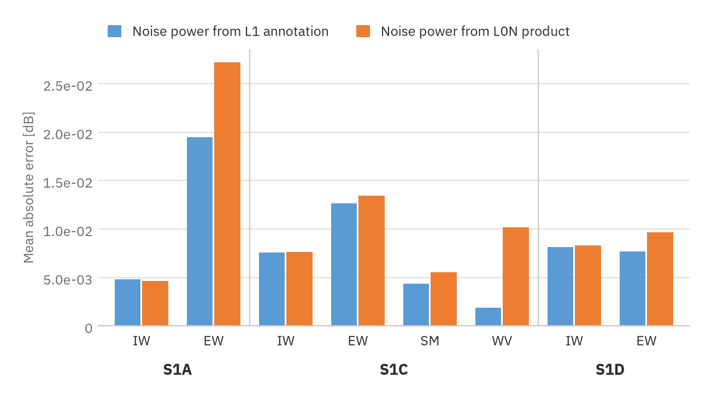{ width="85%" }
  <figcaption>Mean absolute errors between annotated and reconstructed noise maps on SLC products.</figcaption>
</figure>

<figure markdown="span">
  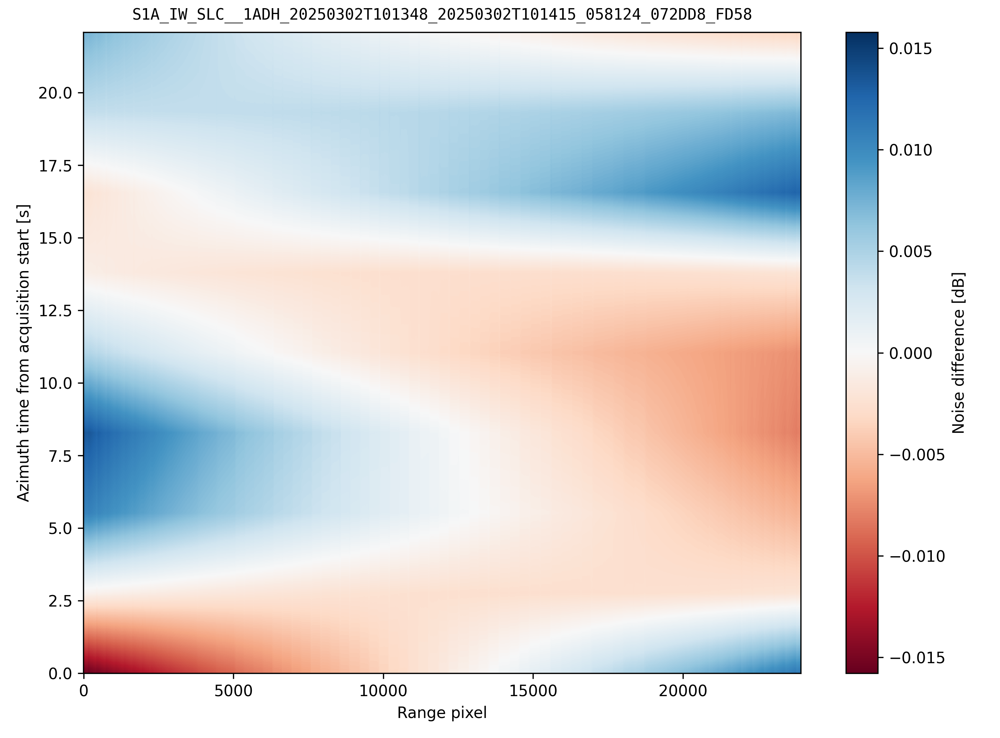{ width="78%" }
  <figcaption>Error between annotated and reconstructed noise maps of an S1A IW SLC product, IW3, HH polarization, no L0N.</figcaption>
</figure>

Comparing nominal and reconstructed noise profiles at a fixed azimuth time, some oscillations are visible. For
subswath EW1, VH polarization of an S1C SLC product, the error over the whole profile is of the order of $10^{-3}$ dB:
the oscillations along the profile are introduced by floating point precision and numerical errors.

<figure markdown="span">
  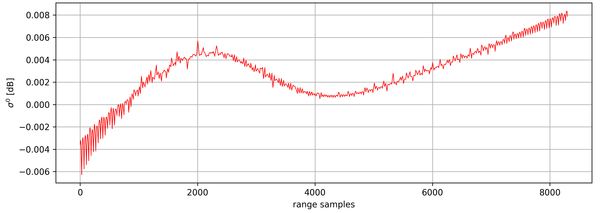
  <figcaption>Error between annotated and reconstructed noise profiles for product <code>S1C_EW_SLC__1ADV_20250502T191252_20250502T191355_002156_00493A_0D61</code>, no L0N.</figcaption>
</figure>

### GRD data

For GRD products the error is slightly higher than for SLC products: for the TopSAR products, $1.44 \cdot 10^{-2}$ dB
when the noise power is read from the L1 annotations, and $1.58 \cdot 10^{-2}$ dB when it is extracted from the L0N
product. This is still very
small, and acceptable for the scope of this work.

<figure markdown="span">
  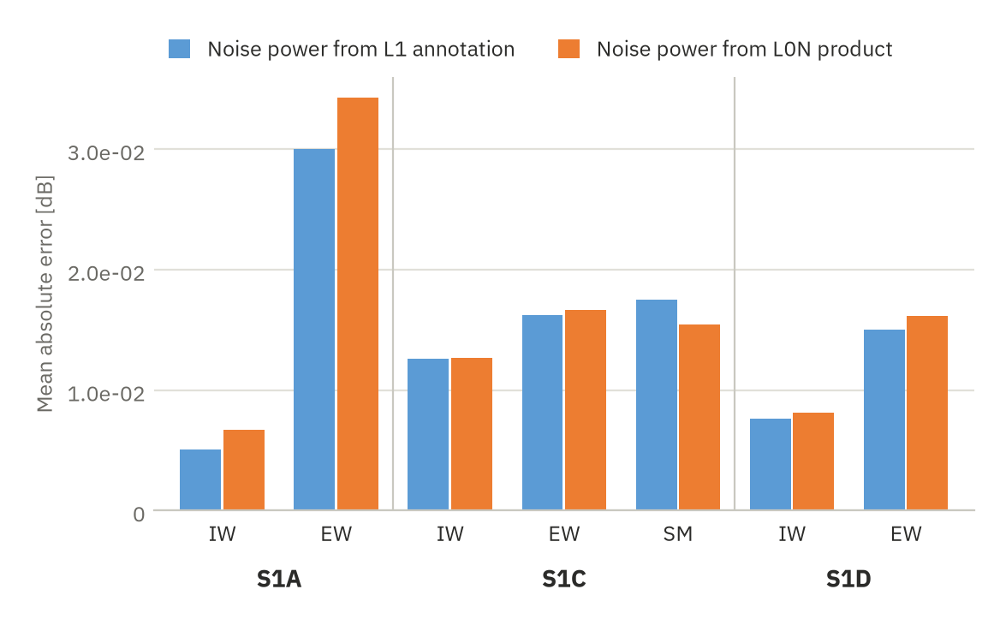{ width="85%" }
  <figcaption>Mean absolute errors between annotated and reconstructed noise maps on GRD products.</figcaption>
</figure>

The GRD case is more delicate, mainly because the subswaths must be correctly separated, processed and
[merged](algorithm/subswath-merging.md) from a single annotation file. For GRDH products this procedure is easier and
the error stays low, as in the following S1C IW GRDH example.

<figure markdown="span">
  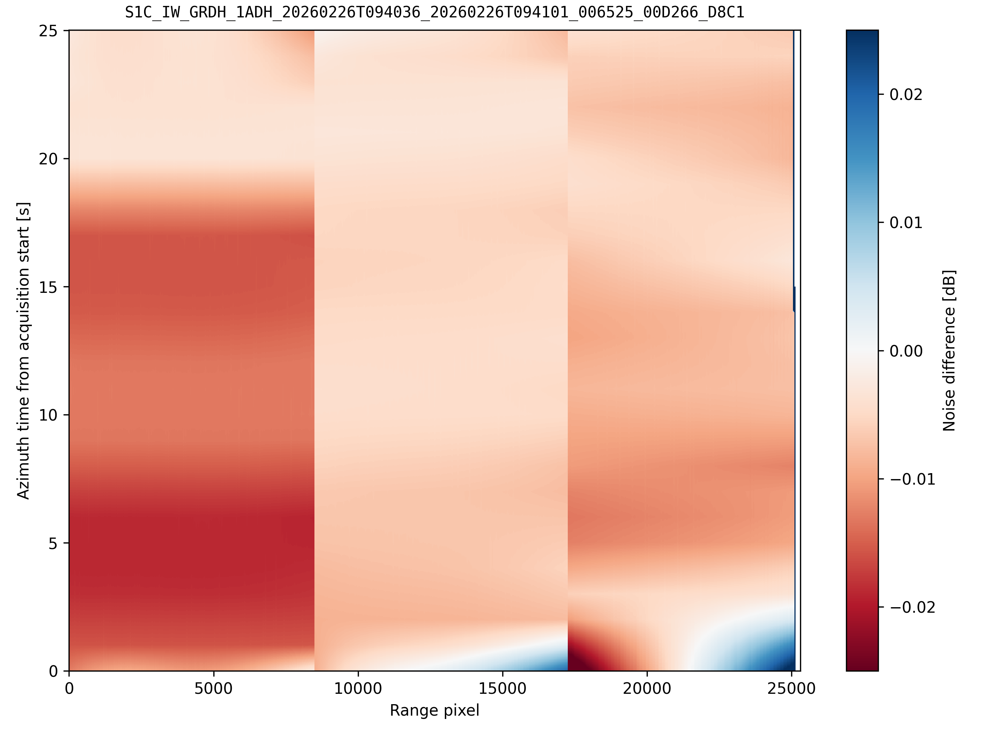
  <figcaption>Difference between annotated and reconstructed noise maps, HV polarization.</figcaption>
</figure>

GRDM products have more irregular acquisition borders, and are therefore more prone to numerical imprecision. In the
following S1A and S1C EW GRDM examples, high-error areas are visible in the rightmost part of the map and at its
bottom, respectively.

<figure markdown="span">
  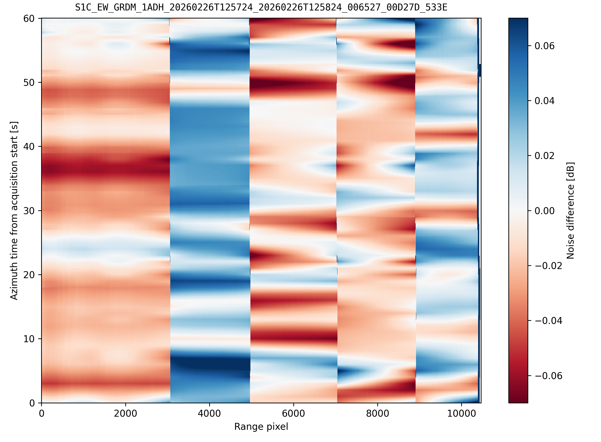
  <figcaption>Difference between annotated and reconstructed noise maps, HV polarization.</figcaption>
</figure>

<figure markdown="span">
  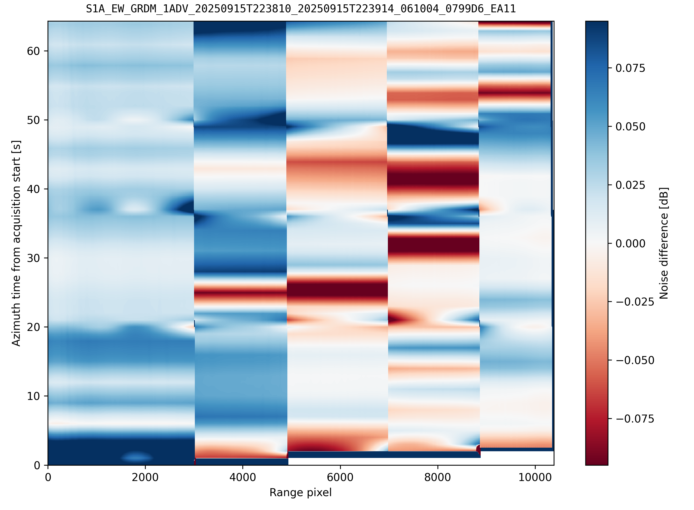
  <figcaption>Difference between annotated and reconstructed noise maps, VH polarization.</figcaption>
</figure>

!!! note "Expected residual differences"

    - **Far-range edge.** At the far-range edge of the outermost subswaths, the nominal annotations set the last 1-3
      noise LUT samples to zero, as visible in the profiles below. This is an empirically observed behavior of the IPF
      output, consistent with the noise estimator lacking valid samples at the extreme antenna beam edge. The processor
      computes a physically meaningful value there by design, to stay self-consistent over the whole image: these
      differences are expected, do not indicate a processing error, and the grid points depending on the zero samples
      of the nominal annotation are excluded from the computation of the errors.
    - **Start of the acquisition.** Narrow horizontal high-error bands may appear across all subswaths at the start of
      the acquisition, because the first valid burst of each subswath begins slightly after the product `startTime`,
      requiring a backward extrapolation of the noise profile. The IPF empirical estimator, working directly on the
      measured data, may yield different values in those initial seconds. The artifact is confined to the opening
      seconds of the scene and does not affect the overall noise model quality.

    The maximum absolute error is therefore dominated by a small number of grid points, at the start of the acquisition
    and at the subswath boundaries, and is not a meaningful quality indicator: the mean absolute error is the
    appropriate figure of merit.

<figure markdown="span">
  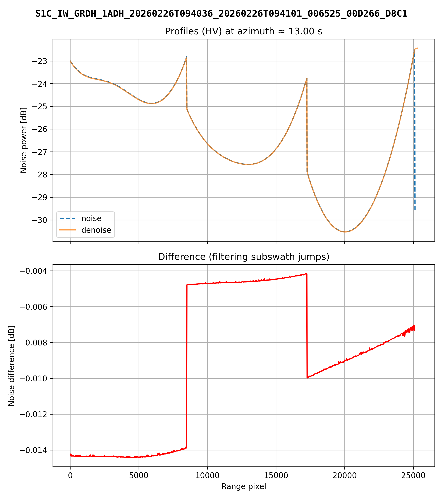{ width="90%" }
  <figcaption>Annotated and reconstructed noise profiles of a GRDH product, HV polarization.</figcaption>
</figure>

<figure markdown="span">
  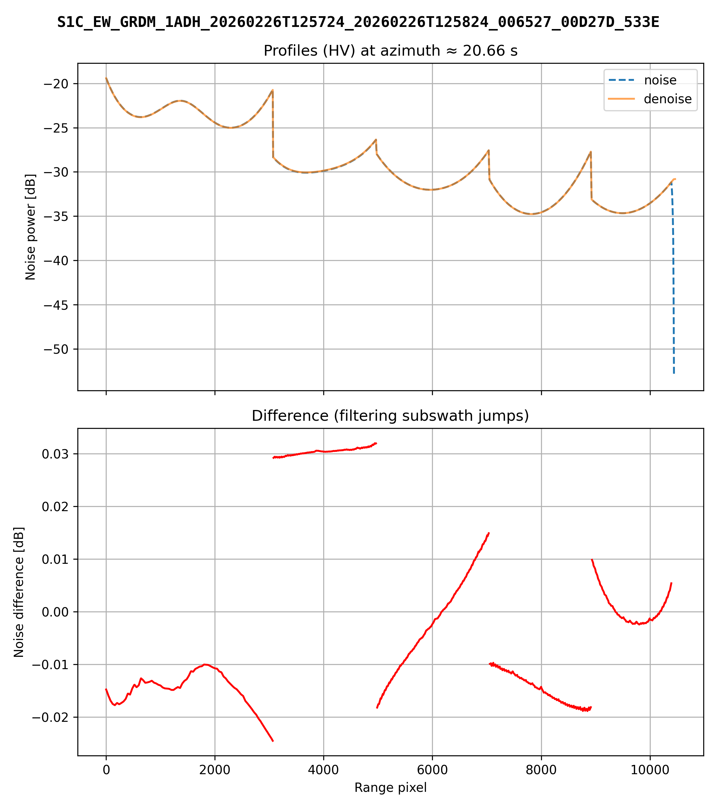{ width="90%" }
  <figcaption>Annotated and reconstructed noise profiles of a GRDM product, HV polarization.</figcaption>
</figure>

## Stripmap and Wave mode dataset

The support for [Stripmap and Wave mode](algorithm/stripmap-wave.md) products was validated on S1C and S1D products,
processed both with the noise power annotated in the L1 products and with the noise power extracted from the
corresponding L0N products.

For Stripmap, three SLC products were selected for each beam (S1 to S6) and mission, together with the S1D GRD
products of beams S3 and S6. The table reports the MAE averaged over the denoise files of each group.

| Mission | Beams                 | MAE, annotated noise [dB] | MAE, L0N noise [dB] |
|:-------:|:---------------------:|:-------------------------:|:-------------------:|
| S1C     | S1 to S6, SLC         | 0.002 – 0.005             | 0.003 – 0.006       |
| S1D     | S2, S3, S4, S6, SLC   | 0.002 – 0.004             | 0.003 – 0.005       |
| S1D     | S3, S6, GRD           | 0.017 – 0.036             | 0.016 – 0.034       |

For Wave mode, 24 SLC products (1286 imagettes of both swaths) were selected over several months, covering two sets of
auxiliary files for each mission.

| Mission | AUX_CAL / AUX_INS       | MAE, annotated noise [dB] | MAE, L0N noise [dB] |
|:-------:|:-----------------------:|:-------------------------:|:-------------------:|
| S1C     | V20250325 / V20250224   | 0.002                     | 0.010               |
| S1C     | V20250427 / V20250224   | 0.002                     | 0.010               |
| S1D     | V20260319 / V20260319   | 0.002                     | 0.004               |

The noise power extracted from WV L0N products is systematically higher than the annotated one by about 0.01 dB,
constant over each data-take, which explains the slightly higher MAE when L0N products are used.

!!! note "S1D commissioning products"

    Higher errors, from 0.2 to 3 dB, are found on S1D products acquired during the commissioning phase (Stripmap beams
    S1 and S5, Wave mode WV2), processed by the IPF with the preliminary AUX_INS V20251110. For these products the
    expected noise power in AUX_INS differs from the measured one by more than the upper bound of the
    [discard interval](algorithm/noise-pulse-discard.md) (up to +2.9 dB for WV2): the noise measurements, or part of
    them, are discarded (and the nominal expected noise power is used when all of them are discarded), while the IPF
    uses them. With the operational AUX_INS the errors are in line with the other products.
